Balancing training and rollout can improve async reinforcement learning (RL) throughput even with fewer rollout resources. In a Qwen3-30B experiment, reducing Rollout nodes from 48 to 32 while keeping 16 Train nodes improved end-to-end throughput by approximately **25%**. In a separate Qwen3.5-35B experiment, increasing staleness covered pipeline bubbles, but gains plateaued while reward became more volatile.

This guide is intended for users who analyze asynchronous RL training jobs with [RL Insight](https://github.com/verl-project/rl-insight). It explains how to assess the load on the Trainer and the Rollouter, which performs inference and sampling, and how to tune three execution modes: `separate async`, `fully async`, and `colocate async`.


The findings are based on experiments with Qwen3-30B, Qwen3.5-35B, and Qwen3-Omni. The examples report the node counts and tuning parameters available from these runs; hardware SKUs and complete run configurations are not specified. Actual gains depend on the model, sequence length, hardware, parallel strategy, and code version. Always validate changes with controlled experiments on the target workload.

The [2026 Q4 roadmap](https://github.com/verl-project/verl/issues/8186) states that `fully async` will be deprecated in the main branch and moved to [`verl-recipe`](https://github.com/verl-project/verl-recipe).


## 1. Tuning Objectives

The goal of asynchronous training is to overlap Trainer and Rollouter work so that each can cover the other's idle time, maximizing end-to-end throughput without compromising training quality.
Based on multiple asynchronous tuning experiments, I recommend focusing on three types of issues:

1. **Rollouter bubbles**: Rollouters typically finish inference for all samples early and wait for new prompts to be supplied after the Trainer completes actor update.
2. **Trainer bubbles**: The Trainer waits for Rollouters to produce samples.
3. **Training quality degradation**: Increasing the degree of off-policy training may cause reward fluctuations or training bias.

Monitor the following signals together:

| Dimension | Key signals | Purpose |
| --- | --- | --- |
| Timeline | Active Trainer/Rollouter intervals, parameter versions, validation intervals | Identify which side is idle and whether the bubbles are periodic |
| Rollout load | Requests per replica, running request, scheduler state, cache utilization | Detect uneven request distribution and idle ranks |
| Training load | Mini-batch execution time, training memory, timing_s/gen | In fully async, timing_s/gen reflects how long the Trainer waits for samples |
| Data distribution | Input and output sequence length distributions | Long-tail sequences can create imbalance across replicas and ranks |
| Training quality | Reward, accuracy, staleness, and RS/IS metrics | Verify that throughput improvements do not cause unacceptable quality degradation |

## 2. Async Modes and Primary Tuning Knobs

| Mode | Resource layout | Main trade-off | Primary knobs |
| --- | --- | --- | --- |
| `separate async` | Training and rollout use different devices. Rollouters have an independent resource pool, and the Trainer uses Hybrid Engines, with more complex switching logic than `fully async` | Mismatch between the Trainer's sample consumption rate and the Rollouters' sample generation rate | Trainer/Rollouter resource ratio, `warm_up_batch`, enable switch, `adaptive_switch_threshold` |
| `fully async` | Training and rollout use different devices. Rollouters have an independent resource pool, and the Trainer uses Hybrid Engines that can participate in inference during validation | Mismatch between the Trainer's sample consumption rate and the Rollouters' sample generation rate | Trainer/Rollouter resource ratio, `staleness_threshold` |
| `colocate async` | Training and rollout share the same devices and execute sequentially | -- | `warm_up_batch` |


Parameter names may vary by branch or version. This guide uses the names from the experiment environment, including `parameter_sync_step`, `warm_up_batch`, and `use_trainer_do_validate`.


## 3. Recommended Tuning Workflow

### 3.1 Establish a Baseline

Keep the model, dataset, total device count, and training hyperparameters fixed. Record at least:

- End-to-end throughput;
- Trainer and Rollouter device counts;
- Train batch, PPO mini-batch, and PPO max token;
- `parameter_sync_step`, `warm_up_batch`, and staleness;
- Validation interval;
- Reward and accuracy curves.

Change only one class of variables per experiment, and compare steady-state throughput outside initialization and warm-up intervals.

### 3.2 Locate the Bottleneck from the Timeline

| Observation | Likely cause | First action |
| --- | --- | --- |
| Rollouters are idle for long periods while the Trainer keeps updating | Excess inference resources or an overly strict staleness limit | Reduce Rollouters in `separate async`; evaluate higher staleness first in `fully async` |
| The Trainer periodically waits for samples | Insufficient rollout throughput or not enough consumable samples within a parameter sync interval | Increase effective rollout capacity, raise `ppo_max_token_len_per_gpu`, or adjust staleness |
| The Trainer is idle during validation | The Trainer does not participate in validation rollout | Evaluate `use_trainer_do_validate` |
| Some replicas or ranks are idle | Uneven sequence lengths, indivisible request counts, or scheduling tails | Check sequence lengths, replica count, and request assignment |
| Reward becomes more volatile as staleness increases | Higher off-policy severity | Reduce staleness or revise the RS/IS strategy |

### 3.3 Tune from Lower-Cost to Higher-Cost Changes

1. Rebalance Trainer and Rollouter resources so that neither side stays far ahead.
2. Eliminate deterministic bubbles, such as validation switching gaps or unsuitable resource divisibility.
3. Adjust batch size, `ppo_max_token_len_per_gpu`, and `warm_up_batch` to increase useful work per phase.
4. Tune parameters that may affect training quality, such as staleness and RS/IS, last.
5. After every change, check throughput, the timeline, and quality metrics together. Do not optimize a single utilization metric in isolation.

## 4. Separate Async Tuning

### 4.1 Understand Hybrid Engines and Standalone Replicas

During `separate async` initialization:

1. The base `_setup()` runs first and creates Hybrid Engines.
2. `init_standalone()` then creates an independent resource pool and starts new rollout servers.
3. Standalone replica ranks start after the Hybrid Engine replicas to avoid Ray named actor conflicts.

The replica count shown in monitoring can therefore be larger than the number of standalone Rollouters. In the following example, there are 32 replicas in total, and replicas `0-7` are Hybrid Engines colocated with the Trainer.

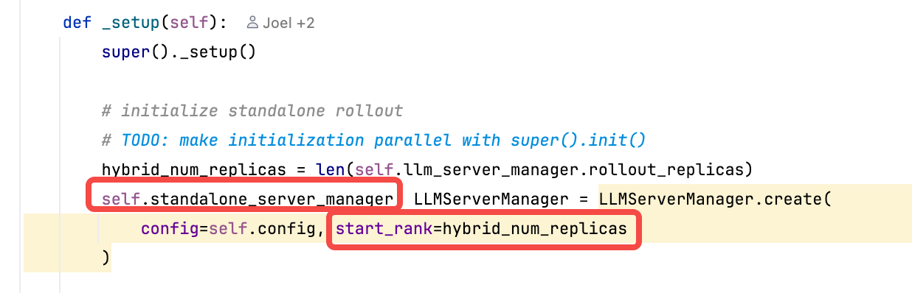

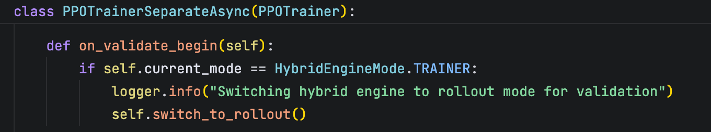

Before tuning, distinguish Hybrid Engines from standalone Rollouters. Do not infer standalone inference resources directly from the total replica count.

### 4.2 Let the Trainer Participate in Validation

In the experimental implementation, Hybrid Engines switch to rollout mode in `on_validate_begin()` and participate in validation, corresponding to the original `use_trainer_do_validate` behavior. After validation, they remain in inference mode until the next replay buffer sample completes and triggers `on_sample_end()`, at which point they switch back to the Trainer.

It is therefore expected to see Hybrid Engines generating around validation:

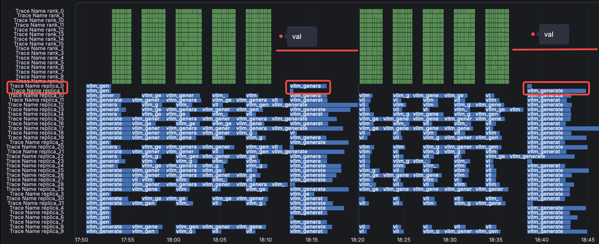

If validation runs at a fixed interval and the Trainer is clearly idle during it, enabling this feature can remove periodic validation bubbles. **This feature is already enabled by default in Trainer V1's Separate Async mode.**

### 4.3 Balance Trainer and Rollouter Resources

#### Case Study: Qwen3-30B

Baseline configuration:

| Parameter | Value |
| --- | --- |
| Train nodes | 16 |
| Rollout nodes | 48 |
| Validation interval | Every 5 steps |
| `gen_tp` | 2, meaning 2 devices per replica |

The baseline timeline shows substantial Rollouter bubbles:

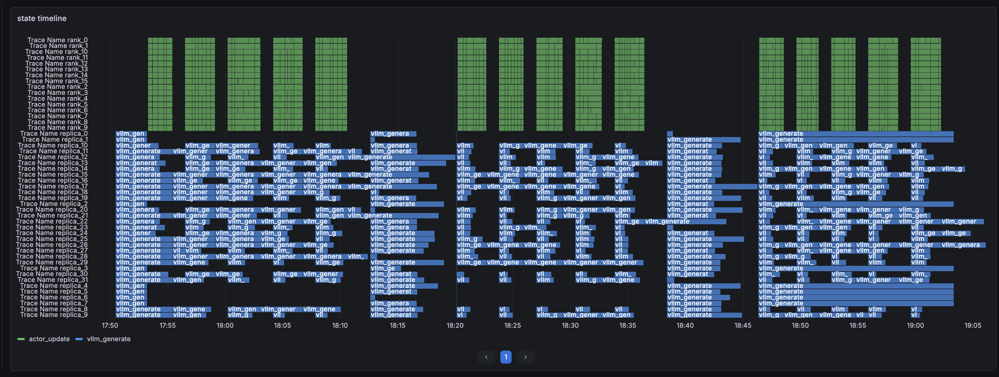

The sequence length distribution is shown below. Length variance must be considered when analyzing load imbalance:

<figure class="fig" style="margin-left:auto; margin-right:auto;max-width:100%;">
  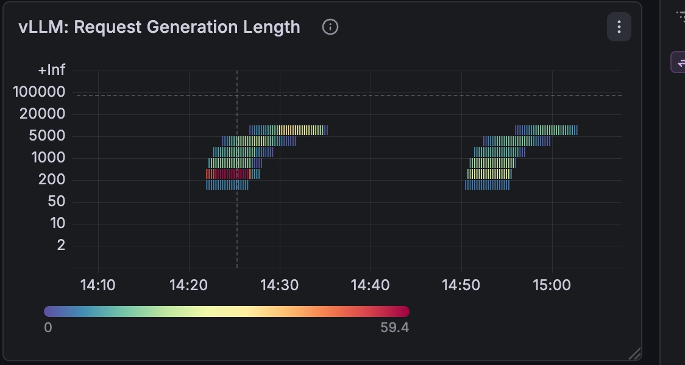
</figure>

Reducing Rollout nodes from 48 to 32 decreased inference bubbles and improved end-to-end throughput by approximately **25%**:

<figure class="fig" style="margin-left:auto; margin-right:auto; max-width:100%;">
  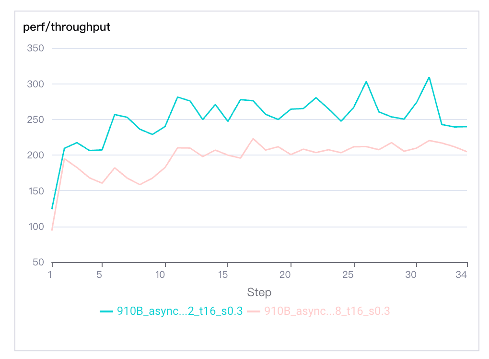
</figure>

This case demonstrates that adding inference resources does not necessarily improve throughput when Rollouters consistently run ahead of the Trainer. Removing excess Rollouters can reduce bubbles and improve throughput per device.

### 4.4 Increase Useful Training-Side Work

#### Case Study: Qwen3-Omni

Initial configuration:

| Parameter | Value |
| --- | --- |
| Train batch | 256 |
| PPO mini-batch | 32 |
| `parameter_sync_step` | 8 |
| `warm_up_batch` | 1 |
| PPO max token | 10k |


Configurations are named after the device split: `r` is the number of Rollouter ranks and `t` is the number of Trainer ranks, so `r8t16` means 8 Rollouter and 16 Trainer.


With `r8t8`, Hybrid Engines can participate in rollout before the first replay buffer sample completes. However, inference is much faster than training overall, so Rollouters run approximately five PPO mini-batches ahead of the Trainer and then remain idle.

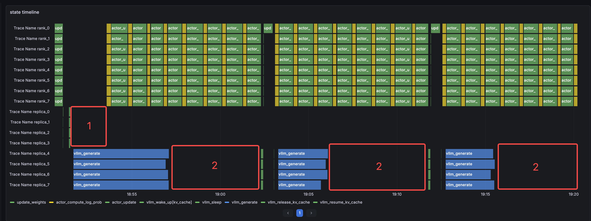

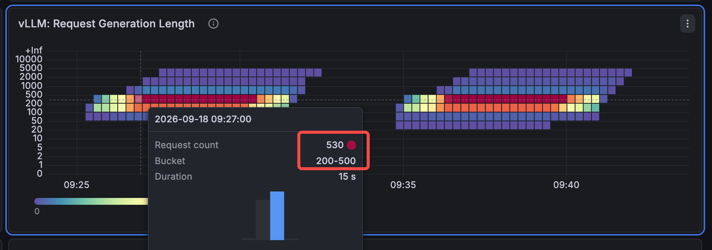

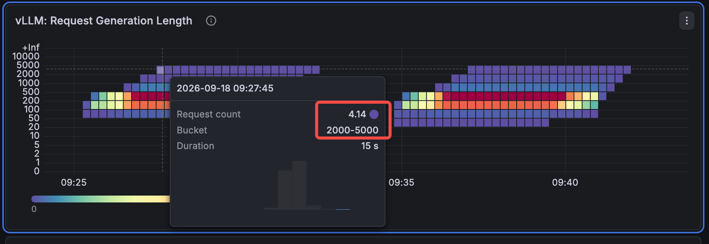

With `r8t16`, increasing `warm_up_batch` to 2 while keeping the other core parameters unchanged reduced the bubble from approximately five to three PPO mini-batches, but there was still room for improvement:

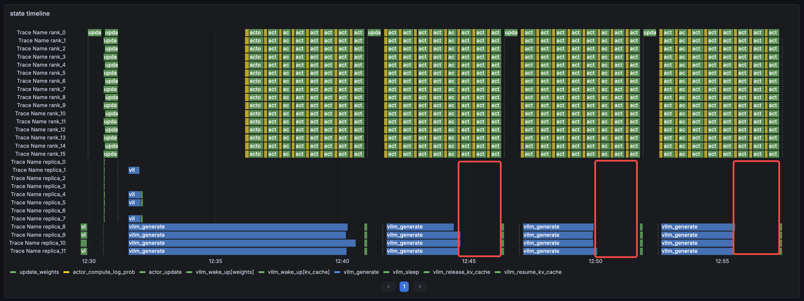

Training memory still had headroom, so the PPO max token value was raised from 10k to 30k to increase training-side work per iteration. The rollout bubble decreased further to approximately 1.5 mini-batches:

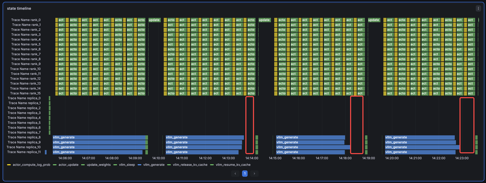

The overall throughput comparison is shown below:

<figure class="fig" style="margin-left:auto; margin-right:auto; max-width:100%;">
  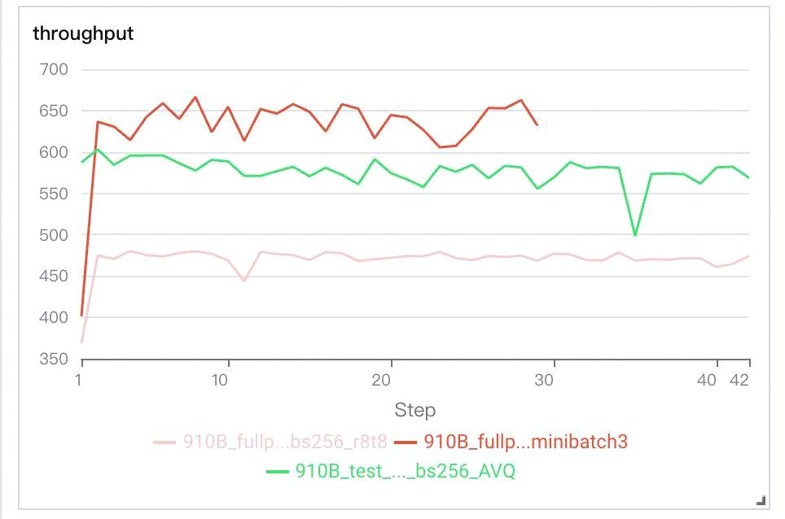
</figure>

The tuning sequence for this case is: first adjust the training-inference resource ratio, then increase the PPO token budget using remaining GPU memory. Before raising the token budget, verify the available memory headroom and maintain a safety margin.

## 5. Fully Async Tuning

### 5.1 Use Staleness to Cover Pipeline Bubbles

Staleness allows Rollouters to continue generating with older parameter versions, increasing overlap between training and rollout. It can reduce waiting time but also raises off-policy severity, so throughput and training quality must be evaluated together.

#### Case Study: Qwen3.5-35B with staleness = 0.3

The yellow lines in the following timeline mark parameter version boundaries:

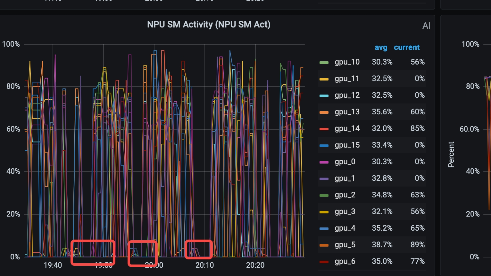

The timeline reveals two types of bubbles:

1. **Rollouter side**: After producing the sample quota corresponding to approximately `1 + staleness`, Rollouters still wait for the Trainer to finish its update.
2. **Trainer side**:
   - Validation every five steps makes the Trainer periodically idle. `use_trainer_do_validate` can switch the Trainer to rollout mode so it participates in validation.
   - The current trigger step is 8. In the experiment, `0.3 / (1/8) > 2`, so extra samples can cover the first two trigger steps. Later Trainer bubbles are mainly caused by waiting for Rollouters.

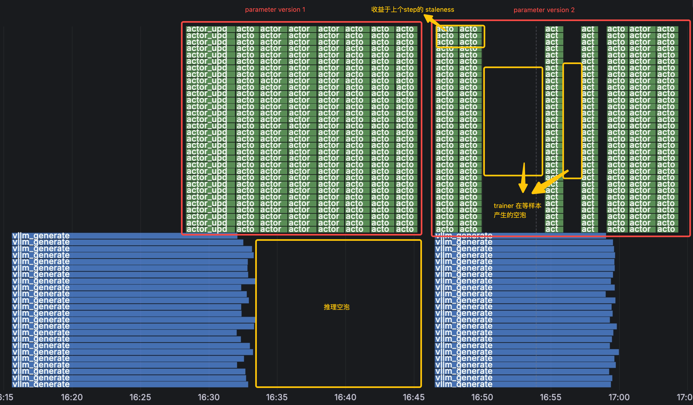

There are two candidate strategies:

- **Add Rollouters**: This may shorten the Trainer's wait for samples, but Rollouters may exhaust the staleness quota sooner and remain idle later in the iteration. If Rollouters already consume most resources, overall resource efficiency may decrease.
- **Increase staleness**: This allows otherwise idle Rollouters to generate more samples and typically covers more bubbles, but it introduces greater training-quality risk.

### 5.2 Compare Staleness Settings

**staleness = 0.3**

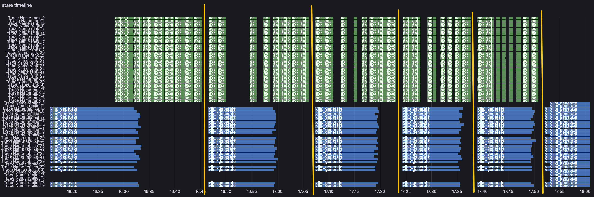

**staleness = 0.5**

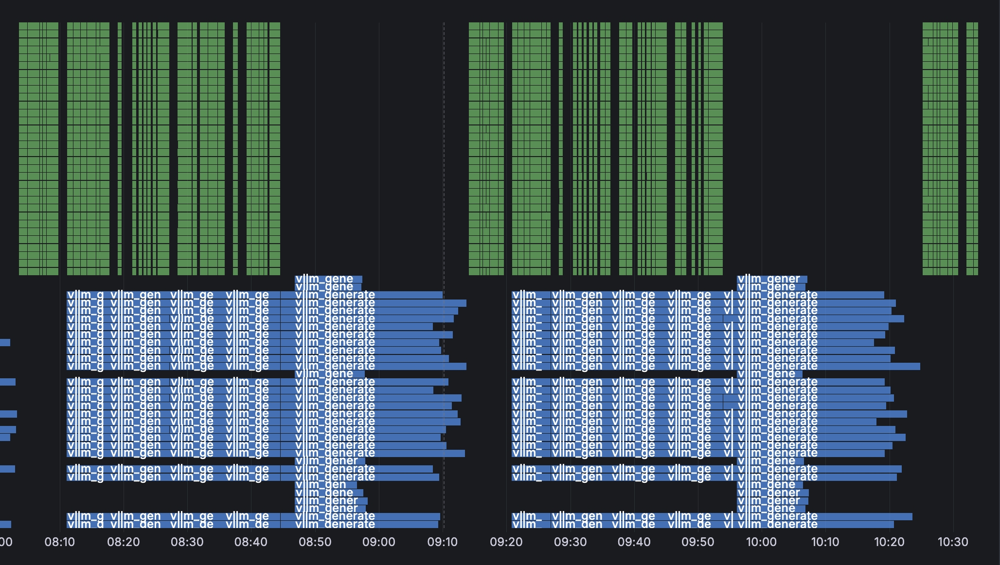

**staleness = 0.7**

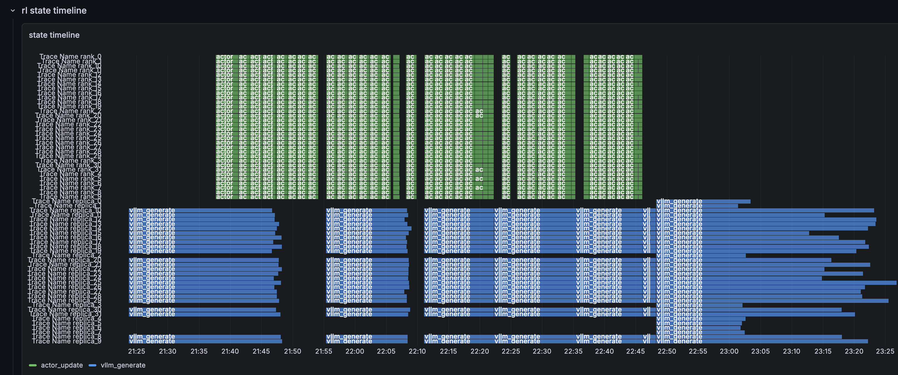

Experimental findings:

1. Increasing staleness noticeably improves bubble coverage between the Trainer and Rollouters from step 2 onward.
2. In these `fully async` experiments, `timing_s/gen` is the time the Trainer waits for Rollouters to generate samples. When `staleness >= 0.5`, this metric fluctuates within a similar range across configurations, indicating limited marginal throughput benefit from further increases.
3. Reward becomes substantially more volatile as staleness increases, while accuracy continues to rise relatively steadily.
4. The RS + IS strategy has a significant effect on reward progression. Staleness must not be selected from system throughput alone.





For this case, `0.5` is a more reasonable starting candidate: it removes most of the waiting while retaining lower off-policy risk than `0.7`. This is not a universal optimum and must be validated on the target workload.

## 6. Key Takeaways

1. **Identify which side owns the bubble before changing resources.** Adding Rollouters is usually ineffective when Rollouters are already idle.
2. **Resource balance matters more than peak performance on one side.** In the Qwen3-30B case, reducing Rollout nodes improved throughput by approximately 25%.
3. **Staleness is a knob between throughput and training quality.** Once waiting time reaches a plateau, do not keep increasing staleness only to improve utilization.
4. **Use the Trainer's switching capability when appropriate.** Letting Hybrid Engines participate in rollout during validation can remove deterministic periodic bubbles.
5. **Convert memory headroom into useful training work.** A higher PPO token budget can reduce the training/rollout speed gap, but stability must be monitored.
