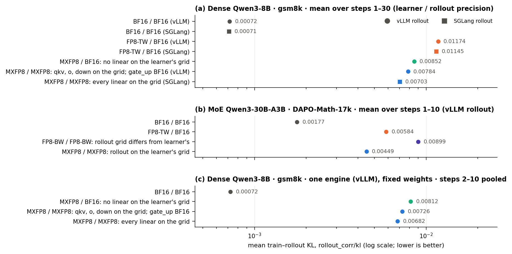
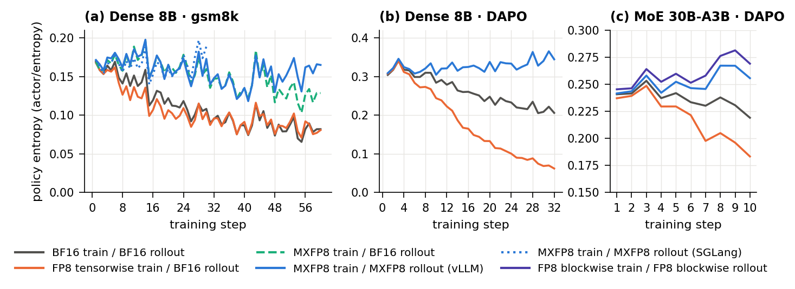

We ran reinforcement learning in MXFP8 on both sides of the loop in verl. The
learner, Megatron-Core with Transformer Engine (TE), computes every decoder
linear layer in MXFP8. The sampler, vLLM or SGLang, serves the same layers in
MXFP8 from weights that the learner's own quantizer produces after every
optimizer step. On NVIDIA B200 GPUs, with Qwen3-8B and Qwen3-30B-A3B, we
measured what this design buys, when it is faster, and how it fails.

## Results at a glance

- **Matching buys consistency, but not BF16's.** For an MXFP8 learner, a sampler
  on the learner's weight grid is more consistent than a BF16 sampler. In one
  engine at fixed weights, train–rollout KL is 16% lower with every decoder
  linear layer on the grid and 11% lower with about half of them, and the
  synchronized weights are byte for byte the learner's FP8 forward weights. On
  the MoE model, an FP8 pipeline whose sampler rounds to a different grid has
  twice the KL from the first step. BF16 end to end is still 2.5–10× more
  consistent.
- **The speed-up is conditional.** MXFP8 training saves a cost per token and
  adds a cost per micro-batch, most of it host-side work between GPU operations.
  On Qwen3-8B it pays off only above about 4.5k tokens per micro-batch. End to
  end, MXFP8 cuts the MoE step time by 10.7% (generation by 24%) and slows a
  short-sequence dense workload by 5%.
- **The failures are silent.** Bringing the pipeline up surfaced seven failures;
  in five, the job exited with code 0 and normal-looking metrics. We state seven
  conditions every weight synchronization must preserve, and run-time checks
  that test them against the live engine, at about 1% of a MoE step.

The MXFP8 training recipe is in verl as of
[#8127](https://github.com/verl-project/verl/pull/8127), with a guide in
[`docs/low_precision/mxfp8.md`](https://github.com/verl-project/verl/blob/main/docs/low_precision/mxfp8.md);
the rollout-side fixes and checks are in review in
[#8327](https://github.com/verl-project/verl/pull/8327).


The measurements were taken on the original implementation,
[verl#7519](https://github.com/verl-project/verl/pull/7519), with vLLM 0.24.0,
SGLang 0.5.12, Transformer Engine 2.16.1 and Megatron-Core 0.18. That pull
request has since been split into #8127 and #8327. In between, verl unified its
low-precision rollout path ([#8287](https://github.com/verl-project/verl/pull/8287))
and moved the default MXFP8 rollout kernels to DeepGEMM
([#8306](https://github.com/verl-project/verl/pull/8306),
[#8308](https://github.com/verl-project/verl/pull/8308)). The consistency and
correctness findings are about the design; kernel names and timings describe
the earlier stack.


## Why low precision on both sides

An RL step has two GEMM-heavy halves: a sampler generates responses and a
learner trains on them. RL needs the two to represent the same policy, but they
are separate implementations, and even in BF16 their log-probabilities differ,
which makes nominally on-policy training slightly off-policy. Quantizing only
one side widens the gap. A BF16 learner with an FP8 sampler serves a
post-training-quantized copy of the policy; an FP8 learner with a BF16 sampler
serves a policy the learner never computes with.

Several frameworks therefore run FP8 on both sides: unified block-wise FP8
pipelines on Hopper,[^jetrl][^unified][^nemo] and, on Blackwell, MXFP8 end to
end in Miles[^miles] and bitwise-identical FP8 weight synchronization in
SkyRL.[^skyrl] Our implementation in verl uses the same principle, which we call
*shared-grid* weight synchronization: the sampler receives the learner's own
quantized weights. What this post adds is measurement.

## The pipeline

The figure at the top of this post shows one RL step. Relative to BF16 RL, only
the weight synchronization changes.

**The format.** MXFP8 is the OCP microscaling FP8 format:[^mx] E4M3 elements in
blocks of 32 along the reduction dimension, each block sharing one power-of-two
(E8M0) scale, for 8.25 bits per element. Blackwell's tensor cores take the block
scales as operands of the matrix-multiply instruction, so MXFP8 is the
hardware's native block-scaled FP8. TE runs its FP8-blockwise recipe on B200 by
emulating it with MXFP8 GEMMs, which is why that recipe needs power-of-two
block scales there.

**The learner** is Megatron-Core with TE's MXFP8 recipe. TE keeps BF16 master
weights and FP32 optimizer states, so checkpoints do not change, and quantizes
the operands of each linear layer's three GEMMs on the fly. Because the
weight-gradient GEMM reduces over tokens, MXFP8 quantizes some operands in
32-element blocks along the token dimension, so verl pads packed sequences to
multiples of 32 under this recipe. Attention, normalization, the embedding, the
output projection (`lm_head`) and the MoE router are not TE FP8 linears and stay
in BF16 or FP32.

**The weight synchronization** passes every weight of a quantized layer through
TE's `MXFP8Quantizer`, the function TE applies to the weight operand of the
learner's forward GEMM. The sampler therefore receives the learner's forward
weight grid, not its own re-quantization of the BF16 weights. It starts from the
BF16 checkpoint with an MXFP8 quantization config injected at launch: no
calibration and no offline conversion.

**The sampler** has to rebuild what its kernels derived at load. Serving
kernels rewrite weights and scales into kernel-specific layouts: swizzled
scales, shuffled and interleaved MoE experts, repacked weights. An update that
writes only the canonical tensors pairs fresh weights with stale layouts, so
after each synchronization verl re-runs the quantization method's
post-processing and folds the result back into the storage that CUDA graphs
captured. `lm_head`, the token embedding and the MoE routers stay in BF16 on
both sides: when `lm_head` was quantized, the logits became NaN while the run
exited normally.

## Setup

| Setting | Model | GPUs | Data, response cap | Sampler | Steps |
| :-----: | :---- | :--- | :----------------- | :------ | ----: |
| A | Qwen3-8B | 2 × B200, TP 2 | GSM8K, 2,048 | vLLM | 60 |
| B | Qwen3-8B | 2 × B200, TP 2 | DAPO-Math-17k, 8,192 | vLLM | 32 |
| C | Qwen3-8B | 2 × B200, TP 2 | GSM8K, 2,048 | SGLang | 30 |
| D | Qwen3-30B-A3B | 4 × B200, TP 2 × EP 2 | DAPO-Math-17k, 8,192 | vLLM | 10 |

*Table 1. The four settings.*

All four use GRPO with 64 prompts × 8 samples per step, a mini-batch of 32
prompts, learning rate 1e-6, a low-variance KL loss to the reference model
(coefficient 0.001), and the same seed and data order in every arm of a setting.
"X / Y" names the learner's precision and then the sampler's. FP8-TW is TE's
per-tensor current scaling with a BF16 sampler. FP8-BW / FP8-BW is verl's FP8
end-to-end recipe, block-wise training with a block-wise FP8 sampler, which on
Blackwell needs power-of-two block scales. MXFP8 / BF16 is an ablation: the
MXFP8 learner with an unquantized sampler. Each arm ran once.

Two details matter below. In settings A and B the vLLM sampler kept every
`gate_up_proj` in BF16 because of an exclusion bug (F2 below), so only the qkv,
o and down projections were on the learner's grid; the SGLang sampler (C) and
the MoE sampler (D) had every decoder linear on it. And setting B ran every arm
with an FP8 KV cache to shorten generation, so its absolute KL is not comparable
with the other settings.

Two controlled experiments then hold everything else fixed, using setting A's
configuration. The **matching experiment** runs four pairings in vLLM at
learning rate 0, so every arm keeps the checkpoint's weights and sees the same
prompts at every step. The **micro-batch sweep** replays recorded trajectories,
so every run trains on identical data, and varies only the micro-batch size.

## Matching: what it buys

verl logs the train–rollout mismatch at every step. We mainly use
`rollout_corr/kl`, the mean over sampled tokens of
\(\log\pi_{\text{rollout}}(y_t)-\log\pi_{\text{train}}(y_t)\), an estimate of
\(\mathrm{KL}(\pi_{\text{rollout}}\,\|\,\pi_{\text{train}})\) under the sampler's
distribution. Lower is better. The other diagnostics verl logs agree with it in
direction throughout.

### One engine, fixed weights

| Learner / sampler | `rollout_corr/kl` | Below the BF16 sampler (95% interval) |
| :---------------- | ----------------: | ------------------------------------: |
| BF16 / BF16 | 0.00072 | — |
| MXFP8 / BF16 | 0.00812 | — |
| MXFP8 / MXFP8, `gate_up_proj` in BF16 | 0.00726 | 10.6% (8.6–12.7%) |
| MXFP8 / MXFP8, every decoder linear on the grid | 0.00682 | 16.1% (14.1–18.1%) |

*Table 2. The matching experiment: vLLM, learning rate 0, Qwen3-8B on GSM8K,
steps 2–10 pooled (576 prompts × 8 samples per arm, the same prompts in every
arm). Intervals from 10,000 bootstrap resamples of prompts, paired across arms.*

Only the sampler changes between the MXFP8 rows. KL falls as more of the
sampler's linear layers join the learner's grid: 10.6% below the BF16 sampler
with `gate_up_proj` left off it and 16.1% with every decoder linear on it; the
last step alone is worth 6.1% (3.9–8.3%). Putting a layer on the grid changes
its weights, the quantization of its input activations and its GEMM kernel at
once, so this measures the recipe as a whole rather than the weights' share.
Over training the order holds as well: SGLang's fully matched sampler
(setting C) is 18% below setting A's BF16 sampler at step 1, and the order
none > partial > full holds at 29 of the first 30 steps.



### The grid, byte for byte

A shared grid holds by construction only if nothing along the way rounds, casts
or misplaces a value. The learner quantizes Megatron's fused,
tensor-parallel-sharded parameters, the synchronization quantizes the exported
tensors inside the vLLM process, and the engine then derives its kernel layouts.
We compared the bytes at two synchronizations of the controlled runs, one of
them after seven training steps had changed 0.84% of the FP8 weight bytes, for
layers 0, 17 and 35, all four projections and both tensor-parallel ranks:

- the engine's E4M3 weights and E8M0 scales equal TE's quantization of the
  synchronized weights;
- the layouts the kernel reads hold the same bytes;
- the learner's cached forward weights equal the same quantization.

In both runs, 0 of about 600 MB differ in each comparison. TE's quantizer and
vLLM's own MXFP8 quantizer also agree byte for byte on all 252 linear weight
matrices of Qwen3-8B.

So with every layer matched, about 84% of the BF16 sampler's mismatch remains,
and it does not come from the stored weights. Write \(e_t\) and \(e_r\) for the
learner's and the sampler's output errors against a common high-precision
reference:

$$\lVert e_t-e_r\rVert^2=\lVert e_t\rVert^2+\lVert e_r\rVert^2-2\langle e_t,e_r\rangle$$

A BF16 sampler has \(e_r\approx 0\) and inherits the learner's whole quantization
error as mismatch. A sampler on the learner's grid makes the weight parts of the
two errors identical, so they cancel. What remains is activation quantization
and the kernels: both sides quantize activations by the same rule, but on
slightly different inputs, which the two engines' BF16 operations (attention,
normalization, accumulation order) produce. SkyRL reports the same structure
with bitwise-identical weights.[^skyrl]

### A different grid, and drift

**A different grid costs from the first step.** On the MoE model (setting D),
verl's FP8-blockwise pipeline quantizes both sides, but on Blackwell its learner
must use power-of-two block scales while its sampler quantizes with FP32 scales,
so the two sides round the same BF16 weight differently. Its KL is twice the
shared-grid pipeline's at step 1, where all arms hold the same weights (0.00921
vs. 0.00446), and stays there (0.00899 vs. 0.00449 over the run). The two
pipelines also differ in the learner recipe and in the sampler's activation
quantization, which these runs do not separate. An MXFP8 learner paired with a
block-wise FP8 sampler has been reported to collapse at 688B scale.[^axk2]

**Per-tensor FP8 drifts; block-scaled FP8 does not.** With a BF16 sampler, the
per-tensor recipe's KL rose 3.1× from the first eight steps to the last eight on
DAPO-Math-17k (0.0100 → 0.0313) and 27% over 60 steps on GSM8K, while the MXFP8 pipeline stayed flat.
That drift is most of MXFP8's late-training margin over per-tensor FP8: 23–70%
lower KL over the last 10 steps of each setting, against 14–23% at step 1 (and
none on DAPO-Math-17k).

**BF16 end to end is still the floor:** about 10× lower KL than any quantized
pipeline on the dense model (setting A) and 2.5× lower on the MoE model.

## Speed: when it pays off

### Fit costs, not step times

Step time is a misleading metric in RL, because the tokens per step change as
the policy learns: in setting A the MXFP8 arm's mean response shortened from
1,247 tokens at step 1 to 599 over the last ten steps, and step time followed. Per-token time does not
fix this, because a fixed cost weighs more as the tokens shrink; setting A's
per-token `update_actor` time ranks BF16 fastest, while its fitted per-token
cost ranks BF16 slowest by 74%. We therefore fit each stage's time per step as
\(t = F + c\,T\) across the steps of one run, using the variation of the tokens
per step \(T\) that RL provides for free. The reference-model pass, BF16 in
every arm, serves as a control: its fitted per-token cost agrees across arms
within 1.4%.

For `update_actor` on Qwen3-8B (setting A), MXFP8 cuts the per-token cost by 43%
(26.7 → 15.4 µs per token) but adds 6.6 s per step. The added cost is paid per
micro-batch, not per step (the sweep below shows this directly): 128
micro-batches here, so 51.5 ms each. The threshold is then a number of tokens
per micro-batch:

$$m^\ast=\frac{\Delta\delta}{\Delta c}=\frac{51.5\ \text{ms per micro-batch}}{11.4\ \mu\text{s per token}}\approx 4.5\text{k tokens}$$

In that run, `update_actor` micro-batches carried about 3.4k tokens and the stage
was 6.9% *slower* under MXFP8, while old-log-prob micro-batches carried about
6.8k tokens and that stage was 4.0% *faster*.


### A controlled sweep

| Micro-batch: sequences (tokens) | Micro-batches per step | BF16 (s) | MXFP8 (s) | MXFP8 − BF16 (s) |
| :------------------------------ | ---------------------: | -------: | --------: | ---------------: |
| 1 (1.3k) | 512 | 69.12 | 84.49 | +15.37 |
| 2 (2.6k) | 256 | 42.90 | 48.71 | +5.81 |
| 4 (5.2k) | 128 | 32.72 | 33.36 | +0.64 |
| 8 (10.3k) | 64 | 32.47 | 24.86 | −7.61 |

*Table 3. The micro-batch sweep: update-stage time per step on identical
replayed data, Qwen3-8B, 2 × B200, mean of steps 2–6.*

A cost paid once per step would leave the difference near −0.9 s at every size.
It instead grows with the number of micro-batches, by 47.0 ± 4.5 ms per
micro-batch in a fit to the sweep alone (51.5 ms inferred from setting A), and
crosses zero near 5k tokens. On its own the sweep pins the break-even point only
loosely, 2.8–7.6k tokens under resampling, because it barely varies the tokens
per step, and BF16's 8-sequence point runs slower than its trend.

### Where the time goes

Nsight Systems traces of the 1-sequence runs show what the added cost is. Per
update micro-batch, MXFP8 launches 912 more kernels, among them 325 that
quantize activations and gradients and 576 that rearrange block scales into the layout
the GEMM reads. Yet the FP8 GEMMs save 7.1 ms, and with kernels merged across
streams the GPU is busy only 5.9 ms longer, 14% of the 43.4 ms added under the
profiler. For 30.6 ms of the rest, the GPU sits idle because the host has not
yet issued the next operation. The added cost is host-side work between GPU
operations: Python, PyTorch's dispatcher and autograd, and the Python layers of
TE and Megatron. SkyRL observed the same kind of cost on H100.[^skyrl]

Three things follow:

- **The host matters.** On a host with a slower CPU, both FP8 recipes made
  `update_actor` 23–31% *slower* than BF16.
- **CUDA graphs** over the micro-batch should remove most of the host dispatch.
  We have not tested this.
- **TE 2.18 and later** write the cached weights' scales in the GEMM's layout.[^te]
  That removes 288 of the 576 rearrangements per micro-batch, a small part of
  the host time.

### A held-out workload, and end to end

With constants fitted on GSM8K, the model predicts the long-sequence
DAPO-Math-17k workload (setting B, dynamic batching at 12,288 tokens per
micro-batch). It predicts per-token savings of 9.0% for the old-log-prob pass
and 15.9% for `update_actor`; we measured 9.1% and 11.9%. A model with a
per-step fixed cost predicts 13.2% and 20.9%. End to end, MXFP8 lowers step time
by 6.4% on that workload and raises it by 5.1% on the short-sequence one.

| Mean of 10 steps | BF16 / BF16 | FP8-TW / BF16 | FP8-BW / FP8-BW | MXFP8 / MXFP8 |
| :--------------- | ----------: | ------------: | --------------: | ------------: |
| Step (s) | 506.0 | 487.2 (−3.7%) | 488.9 (−3.4%) | **451.8 (−10.7%)** |
| Generation (s) | 133.6 | 133.1 (−0.4%) | 115.5 (−13.5%) | **101.7 (−23.8%)** |
| Old log-prob (s) | 63.9 | 64.8 (+1.4%) | 66.1 (+3.4%) | 60.5 (−5.3%) |
| `update_actor` (s) | 244.4 | 225.4 (−7.8%) | 240.8 (−1.5%) | 221.3 (−9.4%) |
| Weight sync (s) | 3.5 | 3.4 | 6.3 | 7.5 |
| Throughput (tokens/s/GPU) | 1,678 | 1,738 | 1,738 | 1,883 (+12.2%) |
| Actor peak memory (GiB) | 60.0 | 67.2 | 74.6 | 75.0 |

*Table 4. Setting D: Qwen3-30B-A3B on 4 × B200, DAPO-Math-17k, mean response
length 6.5k tokens in every arm. Every arm offloaded parameters, ran the
optimizer on the CPU and kept FlashInfer's kernel autotuning off, so these
compare arms rather than show the best achievable times.*

On the MoE model, MXFP8 is the fastest arm in every stage that runs the model in
low precision, and at each of the ten steps. The FP8-blockwise pipeline speeds
up generation by 13.5% but training by only 1.5%, consistent with TE emulating
block scaling through MXFP8 GEMMs on this hardware. Dense generation showed no
clear speed-up at Qwen3-8B's size: in the controlled runs the fully matched
sampler generated 2.0–5.3% more tokens per second than the two BF16 samplers,
which differed from each other by 3.1%. MoE decode is dominated by expert GEMMs whose weight traffic FP8
halves, which would explain the difference; we did not trace it.

FP8 training costs memory, because TE keeps FP8 copies and scales next to the
BF16 weights: the actor's peak allocation grows by 2–5% on the dense model and
by 25% on the MoE model, as much as under the FP8-blockwise recipe. Quantizing
the weights at every synchronization costs about 1 s per step on the dense model
and 4 s on the MoE model including the self-check, 1–2% of a step.

## Correctness: how it fails

Bringing the pipeline up on B200 surfaced seven failures. They share a pattern:
the synchronization reports success, every tensor keeps its shape and dtype, and
yet the sampler no longer computes the learner's policy. Five of them appear
only on Blackwell, because on older GPUs vLLM serves MXFP8 through Marlin or
emulation fallbacks and the native kernels never run.

| | Failure | Breaks | What it looked like | Fix |
| :- | :------ | :----: | :------------------ | :-- |
| F1 | `lm_head` quantized in the sampler (silent) | C1 | reward 0.000 for 20 steps; NaN probabilities; every response at the length cap | keep `lm_head` and the embedding in BF16 |
| F2 | the router exclusion `mlp.gate` also excluded `mlp.gate_up_proj`: vLLM 0.24 matched it as a substring (silent) | C1 | nothing in the metrics | match exclusions on module paths |
| F3 | stale swizzled scales after a sync, SGLang FlashInfer CUTLASS (silent) | C3 | KL 7.2; entropy near uniform; accuracy 0.000 | re-run post-processing after each sync |
| F4 | stale MoE expert layout after a sync, vLLM TRT-LLM MXFP8 MoE (silent) | C3 | KL 0.047, against 0.0022 when healthy | record repacks that keep the shape ([#7986](https://github.com/verl-project/verl/pull/7986)) |
| F5 | BF16 MoE sync on SM100 | C3 | crash at the first sync | stage the weights in place ([#7987](https://github.com/verl-project/verl/pull/7987)) |
| F6 | FP32 block scales on SM100 | C2 | assertion at the first quantization | FP32 scales documented as Hopper-only ([#8062](https://github.com/verl-project/verl/pull/8062)) |
| F7 | checks that ran but printed nothing (silent) | C7 | the audit logged nothing | forward the log level; warn when a check cannot run |

*Table 5. Failures found on B200. Silent: the job exits with code 0 and logs
normal-looking metrics.*

Rather than add one check per failure, we wrote down what a synchronization must
preserve. After every synchronization the sampler must satisfy seven conditions:

- **C1, layer set.** It quantizes exactly the layers the learner runs in low
  precision, and no others.
- **C2, weight grid.** Its quantized weights are the learner's forward weight
  grid.
- **C3, derived state.** Every kernel-specific copy of weights or scales derived
  at load is rebuilt from the synchronized weights.
- **C4, storage identity.** The tensors that CUDA graphs captured are the ones
  that receive the update.
- **C5, completeness.** When the last bucket of a streamed update has been
  loaded, every parameter has been written and every staged buffer folded back.
- **C6, output sanity.** Its token probabilities are finite and its divergence
  from the learner is bounded.
- **C7, observability.** Every check reports a verdict, or why it could not run.

Three run-time checks test them against the live engine:

- **Quantized-layer audit (C1).** Compares the layers that ran FP8 GEMMs in the
  learner with the sampler's rule and with the parameters the engine actually
  holds in low precision.
- **Post-sync self-check (C3).** After every synchronization, one MXFP8 dense
  layer and one expert run through the serving kernel on random input, against a
  BF16 GEMM on the dequantized synchronized weights. Healthy layers show a
  relative error of about 0.027 (dense) and 0.049 (expert), the cost of the
  kernel's activation quantization; stale layouts give errors of order 1. The
  tolerance is 0.25.
- **Sentinel (C6).** Flags a step whose rollout probabilities are non-finite,
  whose `rollout_corr/kl` exceeds 1, or on which every response hits the length
  cap two steps in a row.

Two lessons from the faults that reached training runs:

**Ask the engine, not the configuration.** F2 passed the audit's rule-based
comparison (28 of 28 layers agreed) and was caught only when the audit asked
vLLM which parameters it held in FP8 (56 of 311 parameters disagreed, in a
Qwen3-1.7B run). F4 passed every
check that does not run the kernel, including the audit (69 of 69 parameters
agreed). Only the self-check, which reads the kernel's output, caught it, at the
first synchronization (1.739 against the tolerance of 0.25).

**Divergence alarms cannot replace mechanism checks.** F2's KL (0.007–0.010) lay
inside the range of healthy quantized pipelines, and F4's broken expert layout
raised KL only to 0.047, less than 30% above the highest per-step KL of any arm
we ran (0.037). No threshold separates those. The sentinel therefore keeps a
threshold of 1 for gross failures and leaves moderate faults to the mechanism
checks.

On the MoE model, a synchronization with quantization and the checks took 4 s
longer than a BF16 one, about 1% of a step. The checks come with CPU tests that
inject these violations into stub engines. In
[#8327](https://github.com/verl-project/verl/pull/8327) each check logs a warning
by default and can be set to stop the run, or turned off, through
`VERL_MXFP8_REFIT_CHECK`, `VERL_QUANT_LAYER_AUDIT` and `VERL_QUANT_SENTINEL`.

## Entropy, an open question

The learning signal that separates the recipes most clearly is the policy's
entropy. Under BF16 and per-tensor FP8 it decays, as is usual in RL on reasoning
tasks; under MXFP8 training it stays flat or rises slightly, in both dense
tasks, on both engines and on the MoE model. On GSM8K over 60 steps it fell by
49% under BF16 and by 4% under MXFP8 end to end. The flatter policy is encoded
in the weights: a BF16 sampler evaluating the MXFP8-trained weights sees it too.
And it is specific to the recipe: per-tensor FP8 decays like BF16 on GSM8K and
faster on DAPO-Math-17k (−74% in 32 steps).



Reward and held-out accuracy ended close to BF16's (GSM8K test accuracy after 60
steps: 0.939 for MXFP8 end to end, 0.936 for BF16), so the MXFP8 policy did
learn. Whether the retained entropy is useful exploration or slower sharpening
needs longer runs. It does mean that step-matched checkpoints from different
recipes are not at the same point of training.

## Practical guidance

1. Quantize the sampler with the learner's quantizer, and keep `lm_head`, the
   embedding and the MoE routers in high precision. Check the layer set against
   the engine's live parameters, not against the configured rule.
2. After every synchronization, run the serving kernel of at least one layer of
   each kind against a reference built from the synchronized weights. A healthy
   layer's error is a few percent; a stale layout's is of order 1. Do not rely
   on divergence alarms for this.
3. Estimate the break-even point from one short run by regressing stage time on
   tokens per step, and choose micro-batch token budgets well above it. Compare
   timings only on one host, and do not benchmark FP8 RL at small micro-batches.
4. On Blackwell, prefer MXFP8 to the FP8-blockwise recipe, which TE emulates
   there and which needs power-of-two scales.
5. Watch `actor/entropy` when you change recipes.

## Try it

The recipe merged in [#8127](https://github.com/verl-project/verl/pull/8127)
comes down to two config blocks:

```yaml
# MXFP8 training via Transformer Engine
actor_rollout_ref.actor.megatron.override_transformer_config:
  fp8: "e4m3"
  fp8_recipe: "mxfp8"

# MXFP8 rollout
actor_rollout_ref.rollout.quantization:
  linear: MXFP8
  moe: MXFP8
```

Two example scripts run GRPO end to end, Qwen3-8B on GSM8K and Qwen3-30B-A3B on
DAPO-Math-17k on one 4 × B200 node; `PRECISION=bf16` runs the same job in BF16
for comparison:

```bash
PRECISION=mxfp8 bash examples/mxfp8/run_qwen3_8b_megatron.sh
PRECISION=mxfp8 TOTAL_TRAINING_STEPS=10 bash examples/mxfp8/run_qwen3_30b_a3b_megatron.sh
```

The [MXFP8 guide](https://github.com/verl-project/verl/blob/main/docs/low_precision/mxfp8.md)
lists the requirements (Blackwell GPUs; vLLM 0.29 or SGLang 0.5.20) and the
results of both examples against BF16.

## Limitations

- **One seed, short runs.** Each arm ran once, the four settings for 10–60 steps
  and the controlled runs for 3–12. The intervals above resample prompts within
  one run per arm, not runs. These runs cannot rank final model quality, and we
  make no such claim.
- **Partly matched dense samplers.** Over training, the fully matched dense
  numbers come from SGLang (setting C), a different engine from the vLLM
  baseline; setting B's FP8 KV cache adds a quantization source that the learner
  does not have.
- **One model and one host type for the break-even model.** The sweep confirms
  the per-micro-batch form, but pins the break-even point only to 2.8–7.6k
  tokens on its own.
- **Sampled byte comparison.** It covers 3 of 36 layers of the dense model at two
  synchronizations; the MoE path was not compared byte for byte.
- **No hardware fault-injection campaign.** The evidence for the checks is four
  real faults, two deliberate trips on hardware, healthy runs and CPU tests, not
  measured detection rates.

---

*The implementation, the experiments and this write-up were done with the help
of an AI coding assistant.*

[^mx]: B. D. Rouhani et al., "[OCP Microscaling Formats (MX) Specification, Version 1.0](https://www.opencompute.org/documents/ocp-microscaling-formats-mx-v1-0-spec-final-pdf)," Open Compute Project, 2023.

[^jetrl]: H. Xi et al., "[Jet-RL: Enabling On-Policy FP8 Reinforcement Learning with Unified Training and Rollout Precision Flow](https://arxiv.org/abs/2601.14243)," arXiv:2601.14243, 2026.

[^unified]: InfiXAI, Ant Group AQ, SGLang RL team and Miles team, "[Unified FP8: Moving Beyond Mixed Precision for Stable and Accelerated MoE RL](https://www.lmsys.org/blog/2025-11-25-fp8-rl/)," LMSYS blog, 2025.

[^nemo]: G. Huang et al., "[Run High-Throughput Reinforcement Learning Training with End-to-End FP8 Precision](https://developer.nvidia.com/blog/run-high-throughput-reinforcement-learning-training-with-end-to-end-fp8-precision/)," NVIDIA Technical Blog, 2026.

[^miles]: Z. Li and the Miles team, "[Towards Blackwell-Native 8-bit and 4-bit RL: End-to-End MXFP8 and NVFP4 RL in Miles](https://www.lmsys.org/blog/2026-07-29-mxfp8-nvfp4-rl/)," LMSYS blog, 2026.

[^skyrl]: J. Yao, E. Tang, S. Hegde and K. Hakhamaneshi, "[FP8 Reinforcement Learning in SkyRL: Preserving Policy Consistency Across Training and Rollout](https://www.anyscale.com/blog/fp8-reinfinforcement-learning-in-skyrl)," Anyscale blog, 2026.

[^axk2]: C. Baek et al., "[A.X K2 Technical Report](https://arxiv.org/abs/2608.30181)," arXiv:2608.30181, 2026.

[^te]: NVIDIA Transformer Engine, "[Enable Weight Preswizzling during Quantization in TE Modules](https://github.com/NVIDIA/TransformerEngine/pull/3093)," pull request #3093.
