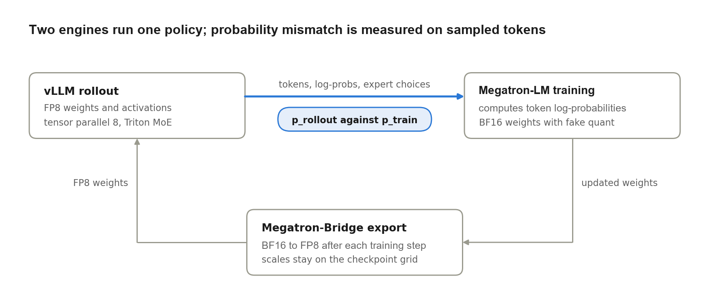
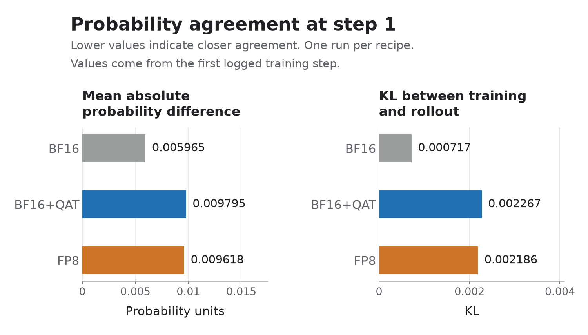
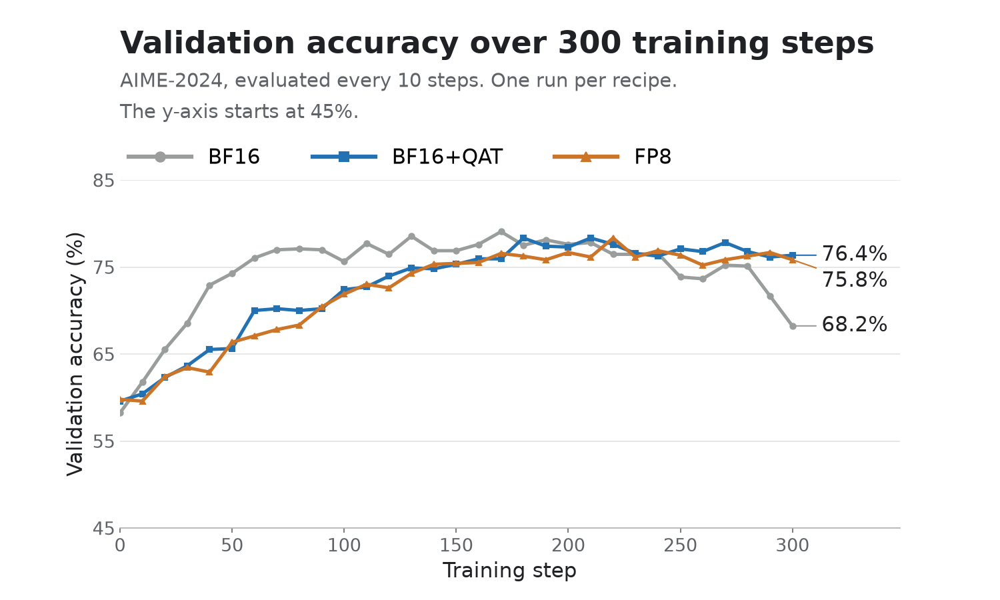

verl now runs DeepSeek-V4-Flash reinforcement learning on AMD Instinct™ MI355X
GPUs. On four nodes (32 GPUs), GRPO training with Megatron-LM and rollout with
vLLM ran 300 consecutive steps without restarts under each of three recipes
(BF16 training with BF16 rollout, BF16 training with quantization-aware
training (QAT) and FP8 rollout, and FP8 training with FP8 rollout) from a single
Docker image on ROCm™ 7.2.3.
Getting there took ROCm enablement work across Transformer Engine, Megatron-LM,
Megatron-Bridge, and vLLM, plus aligning the training engine's quantization
with the FP8 rollout so that the two engines agree on token probabilities. Both
FP8-rollout recipes raised AIME-2024 accuracy from about 60% to about 76%.

We first explain how training is aligned with the FP8 rollout and compare the
first training step. We then follow BF16, BF16+QAT, and FP8 through 300 steps,
looking at validation accuracy, numerical agreement, and training cost.

## Key takeaways

- **Training must reproduce rollout quantization.** We matched FP8 rounding in
  the training computation, KV cache, indexer, and weight export. The two
  FP8-rollout recipes started around 0.0022–0.0023 for training–rollout KL in
  the reported 300-step runs.
- **Three recipes completed 300 steps.** BF16 uses BF16 training and BF16
  rollout. BF16+QAT uses BF16 training with QAT,
  which applies FP8 rounding in the forward pass, and an FP8 rollout. FP8 uses
  FP8 training and FP8 rollout. All three use FP8 KV-cache and indexer
  quantization.
- **BF16+QAT is a useful starting point for an FP8 deployment target when
  numerical agreement matters most.** It had less late-run KL drift than FP8.
  The two FP8-rollout recipes finished near 76% AIME-2024 accuracy. BF16 was
  the fastest per step and had the lowest mismatch; it peaked highest at 79.1%
  but ended at 68.2%.
- **The recipes share one Docker image and script.** Select them with
  `TRAIN_MODE=bf16`, `fp8`, or `qat`. The image includes the required training,
  weight-export, and rollout changes, and the reproduction instructions use the
  recipe merged into verl main.

## The stack

DeepSeek-V4-Flash has 284B parameters, with 13B active per token, 43 layers,
and a context window of up to one million tokens. verl orchestrates the RL
loop, Megatron-LM handles training, vLLM handles rollout generation, and
Megatron-Bridge converts model weights between the training and rollout formats
after each training step.



| Component | Configuration |
| --- | --- |
| Cluster | 4 nodes × 8 AMD Instinct MI355X GPUs (32 GPUs), ROCm 7.2.3 |
| Training | Megatron-LM with Transformer Engine; TP=1, PP=4, EP=8 (one pipeline stage per node, eight expert-parallel ranks per stage) |
| Rollout | vLLM, one engine per node with TP=8 and the Triton MoE backend |
| Weight sync | Megatron-Bridge converts the updated weights to the rollout format after each step |
| Memory | Training and rollout share the GPUs; the optimizer runs on the CPU with its states in host memory, parameters are offloaded to CPU memory during rollout, and vLLM's KV cache is released during training |
| Algorithm | GRPO with a GSPO loss and router replay |
| Data | DAPO-Math prompts for training, AIME-2024 for validation |
| Batch | 64 prompts × 8 samples per step, up to 8,192 response tokens |
| Learning rate | 1e-6 |
| Rollout correction | Token-level truncated importance sampling, capped at 2 (BF16+QAT and FP8 runs only) |

Truncated importance sampling weights each token's loss by the ratio of its
training to rollout probability, capped at 2, to correct for the remaining
mismatch between the two engines. The recipe script contains the full
configuration; software versions are listed in the
[test-environment appendix](#appendix-test-environment).

## Matching training to FP8 rollout

In RL, vLLM generates responses and Megatron-LM computes probabilities for the
same tokens during training. These probabilities should agree closely: a
mismatch biases the RL update, or, with our token-level correction, changes the
weights applied to a response's tokens. Our goal is to make training
reproduce the numerical behavior of FP8 rollout.

On ROCm, the two engines quantize FP8 activations differently by default:
vLLM uses a **floating-point scale** for each 1×128 group (amax / 448), while
Transformer Engine's blockwise recipe, on ROCm as well, rounds that scale up
to a **power of two**, the same convention as DeepGEMM's UE8M0 scales on NVIDIA
GPUs. Weight scales are powers of two on both sides,
as stored in the checkpoint. In the RL loop, training must quantize the same
way as rollout, so training uses floating-point scales for activations and
power-of-two scales for weights.

Training also reproduces the rollout's KV-cache and indexer quantization. The
indexer matters because DeepSeek-V4-Flash's sparse-attention layers use it to
select a subset of compressed KV entries for each query, and FP8 rounding can
change which entries it selects. Router replay makes training reuse the
expert choices made during rollout.

We also
[changed Megatron-Bridge's export](https://github.com/PeterYang12/Megatron-Bridge/commit/658c695c)
so that, when updated weights are re-quantized to FP8 for vLLM, the new scales
are rounded up to powers of two on the checkpoint's scale layout, keeping its
power-of-two (ue8m0) scale format. Before this change, the export recomputed
scales as plain amax / 448, so an unchanged weight came back with about 2.6% RMS
error and vLLM ran a slightly different model after every weight sync; now an
unchanged weight round-trips exactly. Together, these changes keep the
quantization rules consistent through training and weight synchronization.

This alignment supports two training recipes with FP8 rollout. **BF16+QAT**
trains in BF16 arithmetic with forward-pass FP8 rounding that reproduces the
FP8 rollout; gradients pass through the rounding operations. **FP8** trains with
Transformer Engine's FP8 recipe and matching activation scales. Our **BF16**
baseline uses BF16 training and BF16 rollout, while retaining FP8 KV-cache and
indexer quantization.

We check the resulting agreement on the tokens generated at the first training
step. The **mean absolute probability difference**
(`training/rollout_probs_diff_mean`) measures the gap between their token
probabilities; **training–rollout KL** (`rollout_corr/kl`) is the k1 estimate of
KL(π_rollout ‖ π_train): the mean over response tokens of log π_rollout − log
π_train. Figure 2 shows the remaining mismatch for each recipe. These are
numerical checks; AIME accuracy measures task performance.



At step 1, BF16+QAT and FP8 had mean absolute probability differences of
0.0096–0.0098 and KL values of 0.0022–0.0023. BF16 remained lower at 0.0060 and
0.00072, respectively. Different kernel arithmetic can still produce
differences that FP8 rounding amplifies, so the two engines are not
bit-identical. We next examine whether numerical agreement is maintained during
300 training steps, how task accuracy evolves, and what each recipe costs.

## Training results over 300 steps

We next followed the three recipes through 300 training steps and evaluated
AIME-2024 every 10 steps, sampling one response per record with temperature
1.0 and top-p 0.7. Because validation is sampled rather than greedy, each
evaluation carries sampling noise. All three runs used the configuration in
the table above and seed 42, with one run per recipe.



Both FP8-rollout recipes improved from about **60%** accuracy to about
**76%**. BF16+QAT finished at **76.4%**, and FP8 at **75.8%**. BF16 improved
faster early in training, peaked at **79.1%** near step 170, and finished at
**68.2%**. The
curves show useful learning with FP8 rollout, while also showing that the
highest intermediate score and the final score can differ.

BF16+QAT and FP8 improved more gradually. One possible explanation is that
rounding changes how small weight updates affect the rollout model: some
updates stay within an FP8 rounding interval, while others cross into a new
value.


Mean training reward also increased in all three runs. Comparing the first and
last 50 steps, it rose from 0.522 to 0.677 for BF16, 0.447 to 0.646 for
BF16+QAT, and 0.444 to 0.630 for FP8 (Figure 4). These are averages over time
within each run.

Why did BF16 lose accuracy late in training? After about step 150, its
training reward stayed roughly flat, but its policy entropy kept rising, from an
average of 0.14 over steps 101–150 to 0.35 over steps 251–300: the model became
less certain about which token to generate next. Entropy stayed flat or fell in
the other two runs over the same steps. Validation samples at temperature 1.0,
so a less certain model more often samples a wrong step and solves fewer AIME
problems.


BF16+QAT kept closer agreement with rollout than FP8 late in training. Over
the first 50 steps, mean KL was **0.00225** for BF16+QAT and **0.00216** for
FP8. Over the last 50 steps, it was **0.0029** for BF16+QAT and **0.0039** for
FP8. BF16 stayed lower, moving from **0.00077** to **0.00113**. This measures
agreement between engines; the AIME curve separately measures performance on
the task.

The FP8-rollout recipes took longer per step than BF16, mainly because FP8
weight synchronization re-quantizes the updated weights and QAT adds rounding
operations during training; generation time was similar across the three
recipes because each step waits for its longest response.

For an FP8 deployment target, BF16+QAT is a useful starting point when
numerical agreement is the priority. It had less late-run KL drift than FP8,
at a higher cost per step in these runs. BF16 was the fastest per step and
had the lowest mismatch, but its checkpoint is about twice the size; converting
its result to FP8 for deployment needs separate validation.

## Reproduce

[PR #8146](https://github.com/verl-project/verl/pull/8146) is merged into verl
main. Start from a checkout of verl-project/verl main and use the Docker build
arguments below so the image also installs that upstream branch. The
[test-environment appendix](#appendix-test-environment) records the historical
branch used for the reported runs.

| What | Where |
| --- | --- |
| verl | [verl-project/verl](https://github.com/verl-project/verl), main (merged [PR #8146](https://github.com/verl-project/verl/pull/8146)): the Dockerfile (which pins the Megatron-LM and Megatron-Bridge branches), the vLLM patches, and the recipe |
| Megatron-LM | [PeterYang12/Megatron-LM](https://github.com/PeterYang12/Megatron-LM), branch `deepseek-v4-rocm-support` |
| Megatron-Bridge | [PeterYang12/Megatron-Bridge](https://github.com/PeterYang12/Megatron-Bridge), branch `deepseek-v4-rocm-support` |
| Image | `docker/rocm/Dockerfile.rocm.deepseek-v4` on verl main; use `VERL_REPO=https://github.com/verl-project/verl.git` and `VERL_BRANCH=main` when building |
| FP8 checkpoint (`qat`, `fp8`) | [PeterYang12/DeepSeek-V4-Flash-FP8-vllm](https://huggingface.co/PeterYang12/DeepSeek-V4-Flash-FP8-vllm) |
| BF16 checkpoint (`TRAIN_MODE=bf16`) | [PeterYang12/DeepSeek-V4-Flash-bf16-vllm](https://huggingface.co/PeterYang12/DeepSeek-V4-Flash-bf16-vllm) |
| Settings and reference values | the header of `examples/grpo_trainer/run_deepseek_v4_flash_megatron_rocm.sh` |

```bash
# 1. image
DOCKER_BUILDKIT=1 docker build --build-arg VERL_REPO=https://github.com/verl-project/verl.git --build-arg VERL_BRANCH=main -f docker/rocm/Dockerfile.rocm.deepseek-v4 -t rocm-verl-dsv4 .
# 2. Ray inside the container on every node (head first)
ray start --head --node-ip-address=<node ip> --port=6380 --num-gpus=8     # head
ray start --address=<head ip>:6380 --node-ip-address=<node ip> --num-gpus=8   # workers
# 3. training, inside the head container
WK=<wandb key> TRAIN_MODE=qat bash examples/grpo_trainer/run_deepseek_v4_flash_megatron_rocm.sh   # or fp8, bf16
```

The reported FP8-rollout runs started near 0.002 for `rollout_corr/kl` and 0.01
for `rollout_probs_diff_mean`. The recipe enables truncated importance sampling
in every mode; the BF16 run reported here had it off, which corresponds to
`ROLLOUT_IS=null`.

## Upstream support and next steps

This work builds on the DeepSeek-V4 support already upstream in verl, including
ROCm enablement, router replay, and weight-refit fixes. The recipe and
Dockerfile are now merged in
[PR #8146](https://github.com/verl-project/verl/pull/8146).

Next, we plan to:

- Support [DeepSeek-V4.1-Flash](https://huggingface.co/deepseek-ai/DeepSeek-V4.1-Flash).
- Optimize performance and kernels for low-precision training such as QAT and
  FP8, including FP8 weight synchronization and fake-quantization overhead.
- Use batch-invariant kernels in training and rollout, a step toward
  bitwise-identical log-probabilities between the two engines.
- Explore more training modes, such as fully asynchronous training.
- Upstream the remaining quantization-alignment changes.

## Appendix: test environment

| Item | Details |
| --- | --- |
| Nodes | 4 × 8 AMD Instinct MI355X (gfx950, 288 GB HBM), 2 AMD EPYC 9575F CPUs and 3 TB host memory per node; 8 RDMA NICs per node (RoCE v2) |
| Software | Linux 5.15, ROCm 7.2.3, RCCL 2.27.7, PyTorch 2.11.0, Triton 3.6.0, Ray 2.58.0; base image `vllm/vllm-openai-rocm:v0.26.0` |
| Transformer Engine | 2.18.0.dev0 (ROCm build) |
| Megatron-LM | `fd1121b8f` (megatron-core 0.19.0), branch `deepseek-v4-rocm-support` |
| Megatron-Bridge | 0.5.0 plus the power-of-two export fix, branch `deepseek-v4-rocm-support` |
| vLLM | 0.26.0 (ROCm build); AITER 0.1.16.post3 |
| verl | Historical test revision: PeterYang12/verl, branch `dsv4-rocm`. Current reproduction instructions use verl-project/verl main after PR #8146. |
| Data | DAPO-Math-17k training prompts. AIME-2024 validation at step 0 and every 10 steps, with 960 records in each evaluation, one sampled response per record (temperature 1.0, top-p 0.7). |
| Reported numbers | All metrics are from the recorded W&B runs. Early and late averages use steps 1–50 and 251–300 unless stated otherwise. Accuracy is `val-core/math_dapo/acc/mean@1`, recorded at step 0 and every 10 steps. |


## Related work

- [Bringing DeepSeek-V4 Flash RL Training to AMD Instinct MI355X GPUs with Miles](https://www.lmsys.org/blog/2026-07-10-rocm-miles-dsv4/),
  AMD and Miles team, July 2026. The same model and hardware with SGLang
  rollout.
- [Enabling DeepSeek-V4-Flash Training on AMD Instinct MI355X GPUs with Primus](https://rocm.blogs.amd.com/software-tools-optimization/primus-deepseek-v4/README.html),
  AMD, September 2026. Pretraining performance on the same GPUs.
- [FP8 Quantization in NeMo RL](https://docs.nvidia.com/nemo/rl/latest/fp8.html),
  NVIDIA. DeepSeek-style block-scaled FP8 for generation and training, with
  importance sampling recommended to handle the training–inference mismatch.
- [VeOmni pull request 1089](https://github.com/ByteDance-Seed/VeOmni/pull/1089),
  DeepSeek-V4 QAT on NVIDIA GPUs. It uses power-of-two activation scales,
  following DeepSeek-V4's E8M0 scale convention, where we use float scales to
  match vLLM on ROCm.
- [DeepSeek-V4: Towards Highly Efficient Million-Token Context Intelligence](https://arxiv.org/abs/2606.19348),
  DeepSeek-AI, April 2026. Section 3.3 describes the batch-invariant and
  deterministic kernels, and Section 5.2.1 the FP4 quantization-aware training
  used in DeepSeek's own post-training.
- [No More Train-Inference Mismatch: Bitwise Consistent On-Policy Reinforcement Learning with vLLM and TorchTitan](https://vllm.ai/blog/2025-11-10-bitwise-consistent-train-inference),
  vLLM and TorchTitan teams, November 2025. Bitwise-identical log-probabilities
  between rollout and training.
